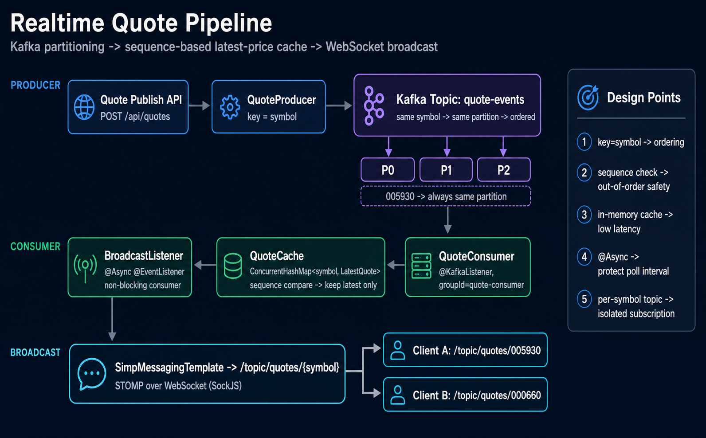

# Order Payment Practice

토스증권 서버 개발자 포트폴리오용 주문·결제 연습 프로젝트입니다.
커머스 도메인 경험을 **정합성 / 동시성 / 멱등**이라는 금융과 닮은 문제로 번역해 보여주는 것이 목적입니다.

## 핵심 설계 포인트

| 문제 | 해결 방식 |
|---|---|
| 주문 상태 꼬임 | `OrderStatus` 상태 전이 메서드로만 변경 (`CREATED → PAYMENT_PENDING → PAID → CANCELLED`) |
| 중복 결제 | `Payment.idempotencyKey` 유니크 제약 + 동일 키 재요청 시 기존 결과 반환 |
| 잔액 정합성 | 계좌에 `@Version` 낙관적 락, 조회 시 `PESSIMISTIC_WRITE` (`findByUserIdForUpdate`) |
| 금액 오류 | `Money` 값 객체에서 음수·잔액 부족 검증 |
| 트랜잭션 원자성 | 결제 서비스의 단일 `@Transactional`에서 출금·Payment 생성·주문 완료 처리 |

## 외부 결제 API(PG) 연동 구조

Mock으로 동작하지만 **실제 연동 코드와 동일한 경계**를 유지합니다. 서비스는 PG 구현체를 모릅니다.

```
PaymentService
  └─ PaymentGateway (interface)
       ├─ MockPaymentGateway   (@Profile "!real")  지연/실패율/강제실패 주입
       └─ TossPaymentGateway   (@Profile "real")   실제tosspayments API 호출 스켈레톤
  └─ GatewayRetry              재시도 3회 + 지수 백오프 (retryable 예외만)
```

### 결제 흐름 (보상 트랜잭션 포함)

1. 주문 상태를 `PAYMENT_PENDING`으로 변경하고 계좌 출금
2. `GatewayRetry`로 PG 승인 호출 (통신 오류/5xx만 재시도, 4xx는 즉시 실패)
3. 승인 금액이 주문 금액과 다르면 실패 처리
4. 성공 → `Payment(SUCCESS)` 저장 + 주문 `PAID` + `transactionKey` 기록
5. 실패 → **별도 트랜잭션(`REQUIRES_NEW`)** 에서 잔액 복구 + `Payment(FAILED)` 이력 저장
   - 같은 트랜잭션에서 예외를 던지면 롤백되므로 보상 로직을 분리해야 함

### 실제 PG로 전환

```bash
SPRING_PROFILES_ACTIVE=real \
PG_TOSS_SECRET_KEY=sk_test_... \
./gradlew bootRun
```

`TossPaymentGateway`가 `POST /v1/payments/confirm`, `POST /v1/payments/{key}/cancel`을 호출합니다.
Basic 인증, 4xx/5xx/타임아웃 예외 분류, 응답 금액 검증이 구현돼 있어 키/엔드포인트만 맞으면 실제 연동 구조로 동작합니다.

### Mock 장애 주입 (테스트/데모)

```yaml
mock:
  pg:
    failure-rate: 0.3
    delay-ms: 500
```

`MockPaymentGateway.forceFailure(true)`로 특정 테스트에서 확정 실패도 만들 수 있습니다.

### PG 관련 테스트 (총 12건 통과)

| 테스트 | 검증 |
|---|---|
| `PG_승인이_성공하면_거래키가_주문에_기록된다` | 승인 결과가 주문에 반영 |
| `PG_가_계속_실패하면_잔액이_복구되고_실패_이력이_남는다` | 재시도 3회 + 보상 트랜잭션 |
| `취소시_PG_취소까지_호출된다` | 환불 시 PG cancel 호출 |

## 실시간 시세 파이프라인 (시세팀 대비)

토스증권 시세팀 공고의 "실시간 대용량 트래픽 / 저지연 이벤트 처리"를 연습하는 영역입니다.
Kafka 브로커가 없어도 단위 테스트로 검증할 수 있게 구성했습니다.



> SVG 원본: `docs/diagrams/quote-pipeline.svg`

```
시세 발행(REST) → QuoteProducer → Kafka(topic: quote-events)
                                      ↓ (groupId: quote-consumer)
                                QuoteConsumer → QuoteCache(최신가)
                                      ↓ ApplicationEvent
                                QuoteBroadcastListener → WebSocket(/topic/quotes/{symbol})
```

### 설계 포인트

| 문제 | 해결 |
|---|---|
| 종목별 순서 보장 | Kafka key를 `symbol`로 지정 → 같은 종목은 항상 같은 파티션 |
| 이벤트 역전/중복 | `sequence` 비교로 최신 시세만 캐시에 유지 (`merge`) |
| 전체 조회 부하 | DB 대신 `ConcurrentHashMap`에 최신가만 캐싱 (저지연) |
| 브로드캐스트 비동기 | `@Async @EventListener`로 컨슈머 스레드를 블록하지 않음 |
| 구독 격리 | 종목별 토픽(`/topic/quotes/005930`)으로 필요한 종목만 수신 |
| 로컬/테스트 | `quote.broadcast.enabled=false`로 WS 없이 캐시만 검증 가능 |

### 실행 (브로커 있을 때)

```bash
KAFKA_BOOTSTRAP=localhost:9092 ./gradlew bootRun

# 시세 발행
curl -X POST localhost:8081/api/quotes \
  -H 'Content-Type: application/json' \
  -d '{"symbol":"005930","price":70000,"volume":100,"sequence":1}'

# 최신가 조회
curl localhost:8081/api/quotes/005930
```

WebSocket 구독: `ws://localhost:8081/ws-quote` (SockJS) → `/topic/quotes/005930` 구독

### 시세 테스트 (5건 추가, 총 17건 통과)

| 테스트 | 검증 |
|---|---|
| `시세가_들어오면_최신가가_갱신된다` | 캐시 갱신 |
| `순서가_뒤집혀_들어와도_시퀀스가_큰_데이터가_유지된다` | 역전 이벤트 방어 |
| `종목별로_독립적으로_최신가가_관리된다` | 심볼 격리 |
| `각_시세_이벤트는_웹소켓_발행_이벤트를_만든다` | 브로드캐스트 트리거 |
| `종목별_토픽으로_시세가_전송된다` | `/topic/quotes/{symbol}` 라우팅 |

## Redis 2차 캐시 + 스냅샷/원본 적재 (확장)

ConcurrentHashMap을 1차 캐시로 유지하고, 그 위에 `QuoteStore` 인터페이스를 둬 구현체를 갈아끼울 수 있게 했습니다.

```
QuoteConsumer → QuoteStore
                  ├─ LocalQuoteCache  (@Qualifier "localQuoteStore") 1차, WS용 저지연
                  └─ RedisQuoteStore  (@Qualifier "redisQuoteStore") 2차, 인스턴스 간 공유

별도 Kafka group(quote-archive) → QuoteArchiveConsumer → 원본 append-only
@Scheduled(5s) → QuoteSnapshotWriter → 체크포인트 스냅샷
```

### 바꾼 지점만 정리

| 파일 | 변경 |
|---|---|
| `quote/store/QuoteStore.java` | 신규 — `update/get/snapshot` 계약 |
| `quote/store/LocalQuoteCache.java` | 기존 `QuoteCache` 코드 그대로, 이름만 변경 |
| `quote/store/RedisQuoteStore.java` | 신규 — Lua로 seq 비교+쓰기 원자화 |
| `resources/scripts/quote-compare-and-set.lua` | 신규 — 분산 환경의 `merge` 대응 |
| `quote/consumer/QuoteConsumer.java` | `QuoteStore` 주입 (WS는 로컬 값으로 즉시 브로드캐스트) |
| `quote/controller/QuoteController.java` | `QuoteStore` 주입 |
| `quote/archive/QuoteArchiveConsumer.java` | 신규 — 별도 consumer group, `(symbol,sequence)` 멱등 |
| `quote/archive/QuoteSnapshotWriter.java` | 신규 — 주기 체크포인트 |

**왜 Lua인가**: `ConcurrentHashMap.merge`는 JVM 안에서만 원자적입니다. 여러 인스턴스가 Redis를 동시에 갱신하면 `GET→비교→SET` 사이 레이스가 생겨, Lua 스크립트로 Redis 단일 스레드에서 비교+쓰기를 한 번에 처리했습니다. `>=` 비교라 재발행 틱도 안전하게 흡수합니다.

** 복구 흐름**: 스냅샷으로 Redis/로컬 캐시 워밍업 → Kafka offset부터 재소비 → seq 비교가 중복 틱을 자동 무시.

### Redis 없이 실행/테스트

```bash
QUOTE_REDIS=false ./gradlew bootRun
```

Redis 서버가 없어도 컨텍스트가 뜨고, 테스트는 로컬 스토어 기준으로 동작합니다. 전체 **21개 테스트 통과**.

## Kafka Batch 스냅샷 + 커밋 후 Offset (최종 구조)

5초 스케줄러(`@Scheduled`)와 별도 메모리 버퍼를 **제거**했습니다. 대신 Kafka가 `poll()`한 배치를 그대로 처리합니다.

```
quote-events
  ├─ quote-consumer        → Redis/로컬 캐시 → Spring Event → WebSocket (실시간)
  └─ quote-snapshot-group  → 배치 수신 → 종목별 최신 seq 집계
                              → DB UPDATE/INSERT (@Transactional)
                              → ack.acknowledge()  (DB 커밋 후에만)
```

### 핵심 3파일

| 파일 | 역할 |
|---|---|
| `quote/snapshot/QuoteSnapshotBatchConsumer.java` | 배치 수신 → 종목별 최신 시퀀스만 남김 → writer 호출 → ack |
| `quote/snapshot/QuoteSnapshotBatchWriter.java` | `@Transactional` 조건부 UPDATE 후 INSERT (seq 비교로 중복 방지) |
| `quote/snapshot/QuoteSnapshotBatchKafkaConfig.java` | `setBatchListener(true)`, `MANUAL_IMMEDIATE`, 무제한 재시도 |

```java
writer.upsertBatch(quotes); // @Transactional 커밋 완료까지 대기
ack.acknowledge();          // 그 다음에만 Offset 커밋
```

DB 저장이 실패하면 예외가 나서 `ack`에 도달하지 못하고, `DefaultErrorHandler`가 **같은 배치를 재시도**합니다.

### 왜 UPSERT를 `MERGE + CASE`가 아니라 `CASE UPDATE → INSERT`로 했나

H2의 `MERGE ... KEY`는 같은 PK에 **전체 행을 먼저 덮어써서** 시퀀스 비교 기회가 사라졌습니다 (테스트로 발견).
그래서 `UPDATE ... WHERE symbol = ?`에 `CASE WHEN ? > last_sequence`를 먼저 실행하고, 영향 행이 0일 때만 `INSERT`하도록 바꿨습니다.
중복 재처리(seq 동일) 시 가격이 덮어써지지 않는 것을 통합 테스트가 검증합니다.

### 실행

```bash
# H2 (기본)
./gradlew bootRun

# MySQL 프로필 (실 운영 구조)
SPRING_PROFILES_ACTIVE=snapshot-mysql \
DB_PASSWORD=... ./gradlew bootRun
```

MySQL DDL은 `docs/diagrams` 설명 대신 아래 참고:

```sql
CREATE TABLE IF NOT EXISTS quote_snapshots (
    symbol VARCHAR(32) PRIMARY KEY,
    price BIGINT NOT NULL,
    volume BIGINT NOT NULL,
    last_sequence BIGINT NOT NULL,
    updated_at_epoch_milli BIGINT NOT NULL,
    version BIGINT NOT NULL DEFAULT 0
) ENGINE=InnoDB;
```

### 장애 시나리오

| 상황 | DB | Kafka Offset | 결과 |
|---|---|---|---|
| UPSERT 중 DB 오류 | 롤백 | 미커밋 | 배치 재시도 |
| DB 커밋 직후 종료 | 저장됨 | 미커밋 가능 | 같은 배치 재처리 → seq 조건이 중복 흡수 |
| 정상 | 저장됨 | 커밋 | 다음 배치 |

### 테스트 (총 24개 통과)

- `DB_저장_실패시_Offset을_커밋하지_않는다` — ack 미호출 검증
- `DB_성공시_Offset을_커밋한다` — 정상 흐름
- `같은_배치에서_종목별_최신_시퀀스만_남긴다` — 4건 → 2건 집계
- `더_큰_시퀀스만_갱신하고_오래된_시퀀시는_무시한다`
- `같은_시퀀스의_재처리는_가격을_덮어쓰지_않는다`

> 운영 시 `max.poll.interval.ms`와 메시지 보존 기간을 함께 관리해야 합니다. 무제한 재시도는 데이터 누락엔 유리하지만 처리 불가 메시지가 파티션을 막을 수 있어, 장애 알림·재시도 관찰·격리 정책이 필요합니다.

## PG 외부 호출을 트랜잭션 밖으로 분리

`PaymentService`는 더 이상 `@Transactional`을 갖지 않습니다. DB 작업은 모두 별도 빈 `PaymentTxService`에 위임하고, PG 호출은 그 트랜잭션들 **사이**에서 수행합니다. (같은 클래스 내부 호출은 Spring AOP 프록시를 안 타므로 빈 분리가 필수입니다.)

```
[pay]
1. txService.reserveAndWithdraw()   ← 트랜잭션 커밋 (출금 + PAYMENT_PENDING)
2. paymentGateway.approve()         ← 외부 API (DB 커넥션/락 없음) ⚡
3. txService.complete()             ← 별도 트랜잭션 커밋 (Payment 저장 + PAID)
   실패 시: cancelApprovedPayment() → txService.compensate() (잔액 복구 + CREATED 복귀)

[cancel]
1. txService.refundWithoutPg()      ← DB 취소/환불 먼저 커밋
2. paymentGateway.cancel()          ← 커밋 후 PG 취소
```

`Order.failPayment()`를 추가해 보상 시 `PAYMENT_PENDING → CREATED`로 되돌립니다. PG 호출이 트랜잭션 밖으로 나가면서 "출금 커밋 후 PG 실패" 상황이 생기므로, 잔액 복구와 함께 주문 상태도 원상복구해야 테스트가 보장하는 원자성이 유지됩니다.

효과: PG 응답 지연/장애 시간 동안 DB 트랜잭션과 계좌 비관적 락이 잡히지 않아 동시 결제 처리량과 장애 격리가 개선됩니다.

## 실행

```bash
./gradlew bootRun
```

서버: `http://localhost:8081` / H2 콘솔: `http://localhost:8081/h2-console`

시드 계좌: `acct-user-1` (user-1, 1,000,000원), `acct-user-2` (user-2, 500,000원)

## API 예시

```bash
curl -X POST localhost:8081/api/orders \
  -H 'Content-Type: application/json' \
  -d '{"orderId":"order-1","userId":"user-1","productName":"노트북","amount":30000}'

curl -X POST localhost:8081/api/orders/order-1/payments \
  -H 'Content-Type: application/json' \
  -d '{"accountId":"acct-user-1","amount":30000,"idempotencyKey":"idem-1"}'

curl -X POST localhost:8081/api/orders/order-1/cancel \
  -H 'Idempotency-Key: cancel-1'
```

## 테스트

```bash
./gradlew test
```

통합 테스트에서 같은 멱등키 중복 결제, 멱등키 충돌, 잔액 부족 롤백, 취소 후 잔액 복구를 검증합니다.
